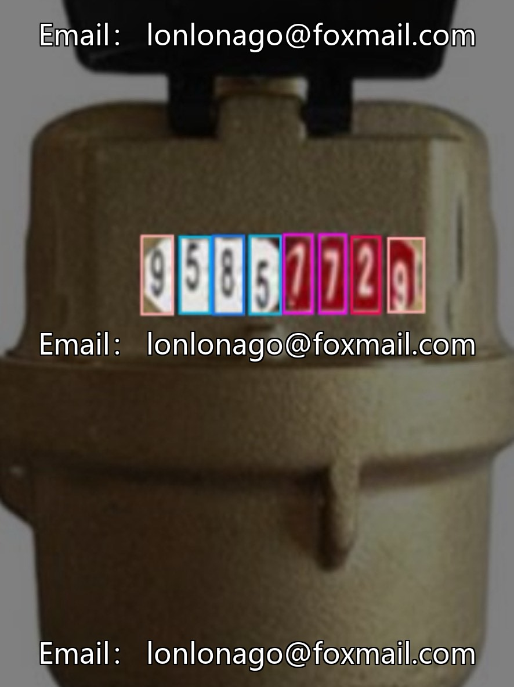
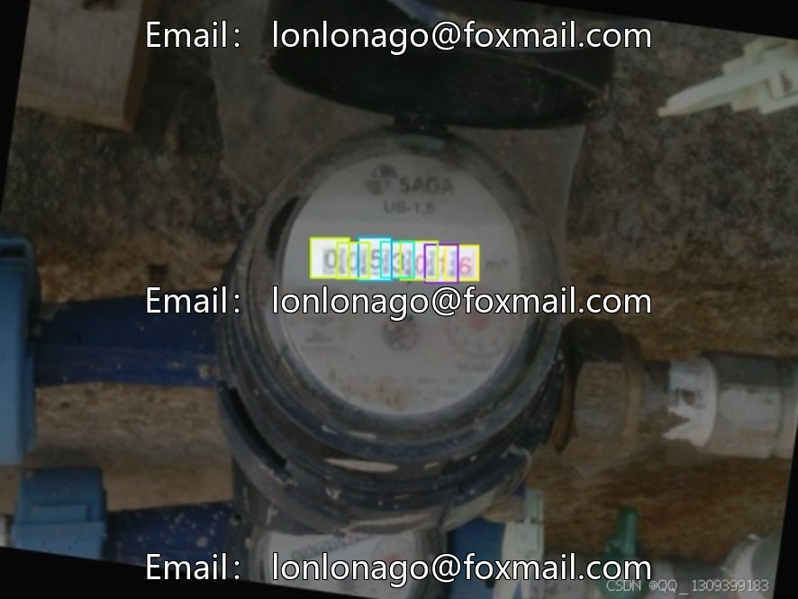
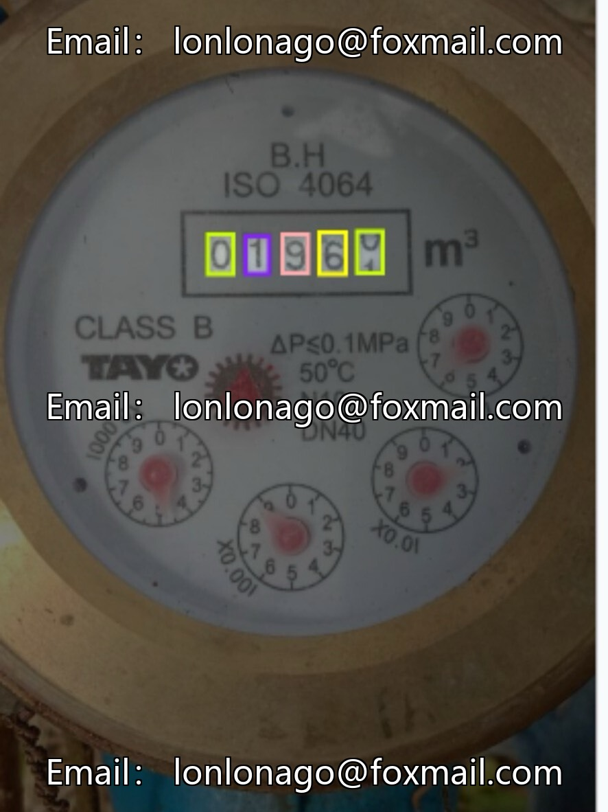
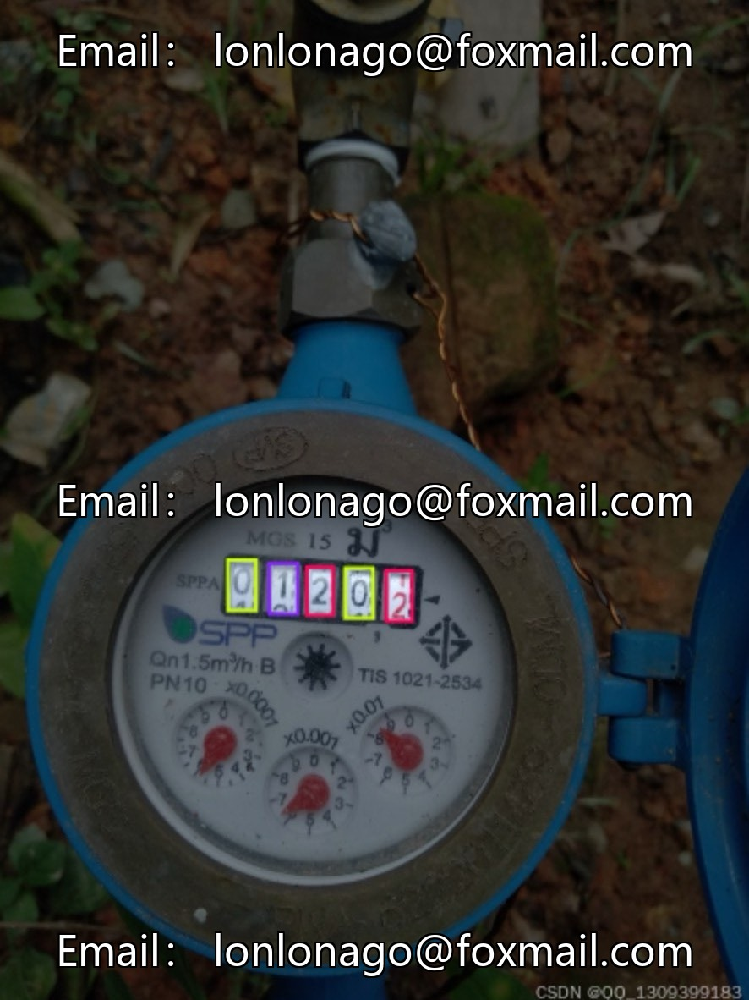
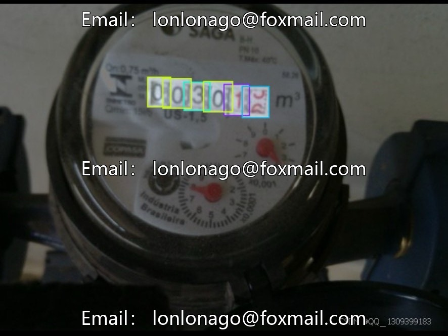
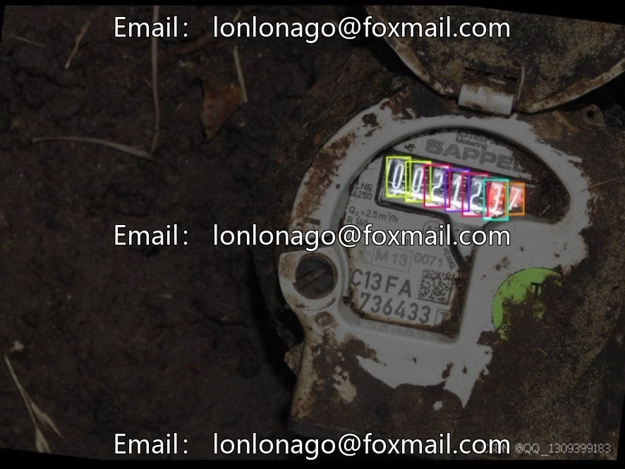

# Automatic Intelligent Instrument Reading Data Set (Digital Recognition of Electric Meters, Water Meters, Gas Meters, and Other Devices)

## Body

Automatic Intelligent Instrument Reading Data Set (Digital Recognition OCR for Electric Meters, Water Meters, Gas Meters, and Other Devices), Issue 10129

The dataset contains 9,547 scene images for reading charts, optimized for recognition of numbers from 0 to 9, suitable for developing automatic reading systems and enhancing the level of metrological intelligence.

Core Category: A total of 10 numbers from 0 to 9
Task Type: Target Detection (Number Recognition)
Total Images: 9,547
Subset Count: 22
Supported Models: 2 (Can be used directly or for secondary development)
Data Format: Image files, supports drag-and-drop or browse upload verification.

Applicable scenarios
Automatic meter reading systems, metering intelligence, algorithm development, etc., for digital identification and entry of water meters, electric meters, gas meters.

The data size is sufficient, with accompanying models and multi-subset designs, suitable for rapid project initiation. It is recommended to enhance the data for actual meter types to improve the model's generalization capabilities on-site.

Virtual materials, once sold, are non-refundable.
Interested friends, click "I want" to proceed.

## Images

## Payment

Here is a pay link on Stripe ( https://buy.stripe.com/3cs8yP7sY87d0vu9AB ). Please contact me lonlonago@foxmail.com after funding $89, and I will send you a complete data files , thank you!

